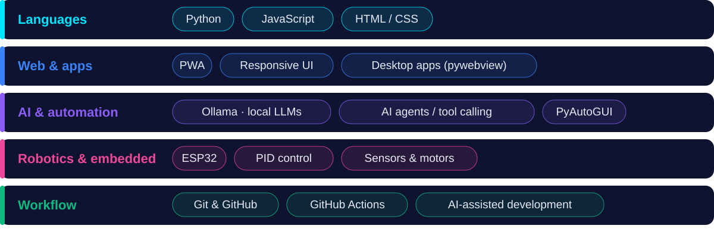
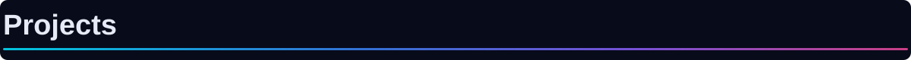
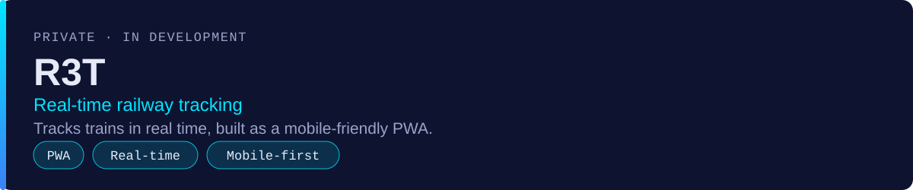
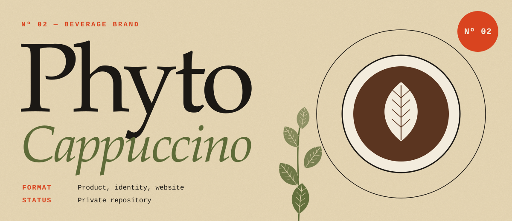
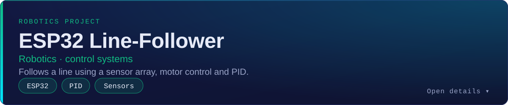
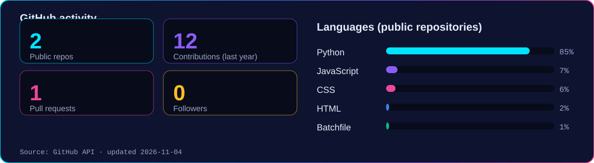

  

  
  
  
  

I'm an engineering student at **ENIT** (École Nationale d'Ingénieurs de Tunis). I like problems where maths, software and hardware meet: a PID loop keeping a robot on a line, a live map of trains, a language model running on my own PC.

I also corun **PHYTO Cappuccino**, a beverage brand I helped building from scratch, so I care about shipping things people can actually use, not only things that compile.

Click a card to expand it.

**What it is.** A real-time railway transportation platform with a mobile-friendly PWA experience, so it works like an app on a phone without an app store.

**Stack.** PWA, responsive web UI, real-time data.

**Links.** The repository is private, so none are shown here.

**What it is.** A beverage brand I'm building: the product, the identity and the website that presents it.

**Stack.** Web (the website lives in a private repository), branding, entrepreneurship.

**Links.** None public yet.

**What it is.** A robot that follows a line. An ESP32 reads the sensors, a PID controller turns the error into steering, and the motors do the rest.

**Stack.** ESP32, sensors, motor control, PID tuning.

**What it is.** A Windows desktop assistant that runs entirely on local models through Ollama: no cloud, no API key. It was my first real project, built over several versions in August and September 2026.

**What it does.**
- Streaming chat with saved conversations
- Agent mode: opens apps and sites, reads and writes files, reports system status, asking permission before typing or overwriting
- Reads PDF, Word, Excel, CSV and images; can answer questions about the screen
- Picks the best installed model per message (code, vision, general)
- Builds small web projects from a description

**Stack.** Python, Ollama, pywebview, PyAutoGUI.

**Repository.** [Oussamabenhenia/local-ai-desktop-agent](https://github.com/Oussamabenhenia/local-ai-desktop-agent)

> R3T and PHYTO Cappuccino are in private repositories. Happy to talk about them directly.

<picture>
  
</picture>

