<b>Contents</b> &nbsp;·&nbsp; <a href="#about">01 About</a> &nbsp;·&nbsp; <a href="#index">02 Index</a> &nbsp;·&nbsp; <a href="#work">03 Work</a> &nbsp;·&nbsp; <a href="#activity">04 Activity</a>

I'm an engineering student at **ENIT**, the École Nationale d'Ingénieurs de Tunis. I like problems where maths, software and hardware meet: a PID loop keeping a robot on a line, a live map of trains, a language model running on my own PC.

I'm also building **PHYTO Cappuccino**, a beverage brand, from nothing. So I care about things that get used, not only things that compile.

<b>Notes on R3T</b>

**What it is.** A real-time railway transportation platform with a mobile-friendly PWA experience, so it works like an app on a phone without an app store.

**Built with.** Progressive web app, responsive web UI, real-time data.

**Links.** The repository is private, so none are shown here.

<b>Notes on PHYTO Cappuccino</b>

**What it is.** A beverage brand I'm building: the product, the identity and the website that presents it. The illustration on the plate is generic botanical art, not the brand's logo.

**Built with.** Web (the website lives in a private repository), branding, entrepreneurship.

**Links.** None public yet.

<b>Notes on the line follower</b>

**What it is.** A robot that follows a line. An ESP32 reads the sensors, a PID controller turns the error into steering, and the motors do the rest. The plate is a schematic (not to scale), not a wiring diagram.

**Built with.** ESP32, sensors, motor control, PID tuning.

<b>Notes on Neural Agent</b>

**What it is.** A Windows desktop assistant that runs entirely on local models through Ollama: no cloud, no API key. My first real project, built over several versions in August and September 2026.

**What it does.**
- Streaming chat with saved conversations
- Agent mode: opens apps and sites, reads and writes files, reports system status, and asks permission before typing or overwriting
- Reads PDF, Word, Excel, CSV and images, and can answer questions about the screen
- Picks the best installed model for each message (code, vision, general)
- Builds small web projects from a description

**Built with.** Python, Ollama, pywebview, PyAutoGUI.

**Repository.** [Oussamabenhenia/local-ai-desktop-agent](https://github.com/Oussamabenhenia/local-ai-desktop-agent)

R3T and PHYTO Cappuccino are in private repositories. Happy to talk about them directly.

<picture>
  <source media="(prefers-color-scheme: dark)" srcset="https://raw.githubusercontent.com/Oussamabenhenia/Oussamabenhenia/output/snake-dark.svg">
  
</picture>

